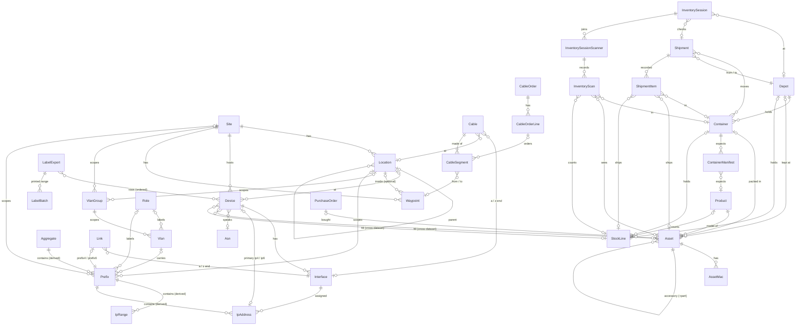
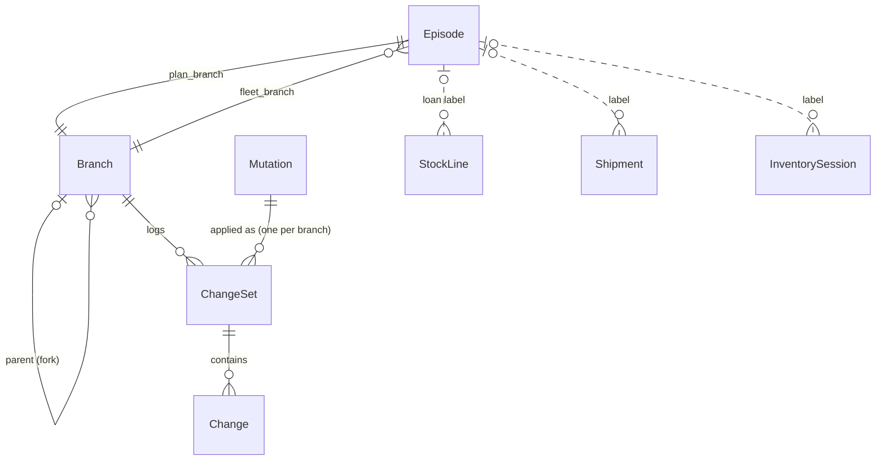

# Domain model (draft)

Status: draft, round 5. Ready to be turned into specs.

This app replaces the per-occurrence NOC spreadsheet ("<name> - Network Data", e.g. Kaigi on Rails 2026) and the standalone asset list ([rubykaigi-network-assets](https://docs.google.com/spreadsheets/d/1u27Eoip0GkvMGRFlqIeH5UZoMCDoXeYDKQ0GOxe7OJ0/edit)). Phase 1 covers IP addresses, subnets, assets, devices and inventory. Cables follow, after planning in the sheet (see the cables section of [`entities-tentative.proto`](entities-tentative.proto)).

## Requirements

- An occurrence is an **Episode** (`rk25`, `rk25kor`, `rk26`, `rk26kor`), never a "conference".
- Assets and inventory (the **Fleet**) have their own timeline, independent of Episodes. Everything else, backbone and venue alike, belongs to an Episode's **Plan**, because the backbone changes during an Episode too.
- An Episode's Plan can fork from any earlier Episode, not only the latest: `rk26kor` forks from `rk26`, and `rk27` forks from `rk26`, not from `rk26kor`. Closed Episodes stay readable for reference. The Fleet only needs snapshots.
- Each Episode records which Fleet version it was built with.
- Every write lands in a **streamlined changelog** for local-first clients. Conflicts resolve last-writer-wins in server commit order, and no submitted update is ever lost. Inventory tracking data in particular must never be lost.
- A client, mobile included, loads one Plan branch plus its linked Fleet branch in full. It never needs all branches at once.
- Generated files reach rubykaigi-net as one pull request per export, opened with a GitHub token from sts-cat. Agents may also read and write through the API.
- `hosts.txt` is replaced by a protojson export whose schema lives in `proto/`. `gen-hosts.rb` and the other automation in rubykaigi-net migrate onto it. The TSV format, which only suited copying from the sheet, is not kept.
- API callers authenticate with himari-issued tokens or with OIDC ID tokens from GitHub Actions and AWS IAM (`sts:GetWebIdentityToken`). Roles are assigned in himari.
- IPAM follows NetBox conventions, which the team already knows.
- `nwa.rubykaigi.org/<tag>` (the QR target on asset labels) opens the asset in this app.
- Cables stay planned in the spreadsheet, which remains their single source of truth. The app imports them repeatedly and handles ordering, receipt, preparing and sending. Cables are consumed per Episode.
- Out of scope: cost tracking (stays in a spreadsheet). Deferred: AP RF configuration, whose single source of truth is the WLC; mirroring it may come later.

## Sources surveyed

### Network Data sheet (kor26 = `rk26kor`)

| Tab | Columns | Maps to |
|---|---|---|
| `networks` | name, 使途, CIDR4, CIDR6, VLAN id, default gateway (v4, v6 suffix `::a`), dhcp pool | Role, Vlan, Prefix, IpRange |
| `addresses` | dc, network, CIDR, IP, name, iface, mac, update, configured?, remark | Device, Interface, IpAddress; `hosts.txt` is a TSV copy |
| `asns` | asn, name (`65010 er.venue`) | Asn |
| `locations` | `[tra] Hall C/メイン`, code, number (number retired) | Location |
| `devices` | ID, 種別 (retired), 場所, SKU, 備考, 調達先, asset tag, MAC | Device and its Fleet fill |
| `device-stock`, `device-sum` | 種別, SKU, 個数, 調達先; requested / stock / remain per category | Asset, StockLine, derived report |
| `ap-name-set command`, `ap-group-set` | true-name, mac-addr, asset-tag, WLC commands, 回収済 | Device + export |
| `ap-annotate`, `assets-ap-annotate` | BSSID (with `?` wildcard) → tag / location | AssetMac (`bssid`) + export |
| `device-tepra`, `ap-tepra` | ID, SKU, label parts | export |
| `入庫申請`, `cardboard-measurement` | box tag, note, W/D/H, count | Container, Shipment export |
| `inventory-check-*`, `kor26出庫` | box, asset URL, code (URL stripped to tag for XLOOKUP), ある? (cross-check) | InventorySession, InventorySessionScanner, InventoryScan |
| `cables`, `cables-sum`, `cables-order*`, `jj-order`, `cables-tepra*` | cable plan, measured length, medium, colour; order sums; JJ order; labels | Cable and CableSegment (imported), CableOrder + exports |
| `cost` | amount, desc | out of scope |

### Asset sheet (rubykaigi-network-assets)

- `master`: handle (tag), chassis, serial, mac, system, license, purchased_at, po, price, price-tax, location, comment.
- `README`: the tag grammar. Container prefixes: `rkc-` folding container, `rkb-` cardboard box (being phased out), `rks-` suitcase, `kor-` Kaigi on Rails cargo.
- `ap-annotate`: BSSID → AP tag. `tepra`: tag → `https://nwa.rubykaigi.org/<tag>`.
- `containers2022`, `containers2024`, `containers2024kor`, `containers2025tokyo12`: contents per box at each move. They mix asset tags, untagged devices (`IX2215 * 2 (tun-01,02.rk24)`) and consumables with rough counts (`はさみ 13本`, `2P電源タップ いっぱい`). `とりだす` marks what to ship from the warehouse; Kaigi on Rails is smaller and takes a subset.

### rubykaigi-net consumers

- `gen-hosts.rb` reads `hosts.txt` (`dc network cidr ip name iface mac`). It emits `<name>.<dc>.rubykaigi.net` A/PTR for the first row per `[dc, name, family]`, `<iface>.<fqdn>` for every row, and `<network>.<fqdn>` CNAMEs. It also writes `deadman.conf`.
- Kea reservations keyed by MAC, DUID or client-id `\0<asset tag>` (`reservations_asset_tag.libsonnet`). Pools and options stay in the repo.
- `route53/rubykaigi.net.route`: `es-<area>-NN.venue` → `<asset tag>.venue` CNAMEs. Other hand-kept records stay in the repo.
- glazed, SNMP and trapbridge host lists by platform; the per-Episode cloudprober exclusion list; itamae node attributes (addresses, DUIDs, ASNs).

## Datasets

| Dataset | Timeline | Entities |
|---|---|---|
| **Fleet** (one, global) | continuous on main; frozen snapshots | Product, Asset, AssetMac, PurchaseOrder, Depot, Container, ContainerManifest, StockLine, Shipment, ShipmentItem, InventorySession, InventorySessionScanner, InventoryScan |
| **Plan** (one main branch per Episode) | forked from any earlier Plan branch; frozen when the Episode closes | Site, Location, Role, Aggregate, VlanGroup, Vlan, Prefix, IpRange, IpAddress, Device, Interface, Link, Asn, LabelExport, LabelBatch, Waypoint, Cable, CableSegment, CableOrder |

- The only cross-dataset reference is Plan → Fleet: a Device's fill (an Asset or a StockLine). Fleet never points at a Plan, apart from an optional Episode label on a Shipment or InventorySession.
- Each Plan branch belongs to one Episode, so per-Episode facts live directly on Plan rows. `es-tra-01`'s location, asset and deployed state are columns of its Device row in `rk26kor`. Forking `rk27` from `rk26` copies the Devices, and the fills are then edited.

## Branches and snapshots

### Concepts

- **Episode** (`ep`): one occurrence, such as `rk26` or `rk26kor`. It points at its main Plan branch (`plan_branch`) and at the Fleet branch its fills resolve against (`fleet_branch`): Fleet main while the Episode is open, and the Fleet snapshot taken at close.
- **Branch** (`br`): one line of history of one dataset, with a `parent` and a `head_seq` (see [Changelog](#changelog)).
- **Snapshot**: a frozen branch. It keeps its own rows, so reading it never replays history.

Operations:

- **Fork an Episode**: create a Plan branch from any Plan branch at its head, typically a closed Episode's frozen main. The fork graph is the `parent` chain: `rk26 → rk26kor`, `rk26 → rk27`.
- **Close an Episode**: freeze its Plan branch, snapshot Fleet main, and point `fleet_branch` at the snapshot.
- **Fleet snapshot** at any other moment, e.g. after an audit. Fleet main is the only writable Fleet branch.
- **Import a past Episode** (rk25, rk26 …) from its sheet into a frozen Plan branch. Pair it with a Fleet snapshot rebuilt from that year's `containers20xx` tab where one exists.
- **Merge** is not planned. Cherry-picking single entities across branches works through lineage.

### Eager copies

Forks and snapshots copy rows eagerly. The data is small (about 460 addresses, a few hundred devices, ~260 assets, ~1,300 cables), and every read stays a plain `where branch_id = ?`. DSQL allows 3,000 mutated rows and 10 MiB per transaction, so copying runs as a background job in chunks. The branch stays `preparing`, and rejects writes, until the job finishes.

### Row identity

- Every branched table has a UUID primary key `id` (a TypeID in the API), unique per row and per branch, plus `branch_id` and `lineage`.
- `lineage` stays the same when a row is copied into a fork, and is unique per branch.
- References inside a branch are ordinary foreign keys on `id`. A fork rewrites them through a lineage map while copying. Single-column keys keep Rails and `typeid_rails` simple.
- Cross-dataset references (a Device's fill) are also plain `id`s, pointing into the Episode's `fleet_branch`. They are remapped through lineage whenever that branch changes:
  - closing an Episode rewrites its fills from Fleet main to the new snapshot, in the same job, before the Plan branch freezes
  - forking a Plan branch rewrites fills to Fleet main; a fill whose asset or stock line is gone from main is cleared with a warning
- `lineage` is used only to follow one item across branches and history: remapping on copy, branch diffs, "this device in rk25", and cherry-picks. It is never a foreign key. The API exposes it.
- `lineage` is the `id` of the row's first incarnation: a UUID, exposed as a TypeID with the entity's prefix. Clients generate `id` (and with it `lineage`) when they create a row. That matters offline: a scanner at the venue can register a new asset and assign it to a Device before syncing, and the fill needs the asset's `id` at once. A server-assigned number would not exist yet.
- Neither `id` nor `lineage` is meant for people. People refer to natural keys:
  - asset and container tags
  - Episode slug + device FQDN (`rk26kor` / `es-tra-01.venue`)
  - cable IDs
  - prefixes and addresses
- UI URLs use natural keys where they are stable (`nwa.rubykaigi.org/<tag>`, `/<episode>/devices/<site>/<name>`). They fall back to TypeIDs for rows without one.

## Changelog

Every branch has an append-only changelog. It is the sync feed for clients and the audit history.

- **ChangeSet** (`cs`): one per branch per committed transaction.
- **Change** (`c`): one per touched row, with its full after-image.
- **Mutation** (`mut`): the journal of client requests, one per API request, applied or rejected.
- Their fields are in [`entities-tentative.proto`](entities-tentative.proto).

Every row in the Plan and Fleet diagram also belongs to one Branch (`branch_id`); that is not drawn there.

Rules:

- A write transaction increments `branches.head_seq` and uses the new value as its `seq`. Concurrent writers on one branch conflict on that row, so DSQL's OCC orders commits. Every `seq` then appears in commit order with no gaps, and a client that has applied up to N misses nothing by asking for `> N`. DSQL sequences cannot provide this, because they hand out cached blocks with gaps and out of commit order.
- Conflicts resolve per field, last writer wins, in server commit order. What a write overwrote is the row's previous Change, and the Mutation journal keeps every request ever submitted, rejected ones included, so an operator can restore any of them.
- Inventory data is insert-only. Scans and shipments are new rows, never updates, so concurrent scanning cannot lose a record. Derived state (an asset's container, a stock line's last observed count) is updated in the same transaction.
- Derived inventory state is the exception to commit-order last-writer-wins: it follows the scan with the latest `scanned_at`. A scanner that was offline uploads its scans late, and an older sighting must not override a newer one.
- Entity tables hold current state plus `updated_seq`. Reading current state never needs the changelog.
- Client bootstrap: fetch all rows of one Plan branch and its Fleet branch with their `head_seq`, then pull or stream Changes after it. Frozen branches never change, so their bootstrap payloads can be cached on S3/CloudFront. Mobile clients keep only the active pair.
- Deletes appear as `delete` Changes and remove the row from the entity table.
- A fork writes one ChangeSet per copied chunk, so a new branch's log starts with a full image.
- One transaction may write to several branches, e.g. a pair scan that fills a Plan Device and updates a Fleet Asset. It increments each touched branch's `head_seq` and writes one ChangeSet per branch, so the change is atomic and each branch's log stays gap-free.

## Validation warnings

Some rules warn instead of rejecting. Warnings are computed per branch and shown in the UI and API:

- duplicate IP address in a branch (`10.33.22.150–155` today)
- asset tag kind not matching its product (`srnp` on a non-PoE switch)
- device fill not matching the device's required category
- cable ends or waypoints not matching Interfaces, Links or Locations (topology check)
- a sheet JJ count that disagrees with the count derived from cable runs and waypoints
- address outside every Prefix; Prefix outside every Aggregate
- device without a primary IP
- shipment that misses something the Plan needs (see `Shipment` in the proto)
- disposed or lost container that still holds assets or stock lines
- inventory session findings: missing (left-behind) assets, unchecked boxes, manifest shortfalls (see `InventorySession` in the proto)

## Entities

Entity shapes, vocabularies and per-entity rules live in [`entities-tentative.proto`](entities-tentative.proto), grouped as here: Plan (organisation, IPAM, devices, cables) and Fleet. Every Plan and Fleet table carries `branch_id`, `lineage`, `updated_seq`, `created_at` and `updated_at` (`Row`), and natural keys are unique per branch.

## Lifecycles

How the Fleet records change over time, from purchase to disposal.

### A tagged asset

`rk-aph26a3`, a Wi-Fi AP bought in 2026, through one Episode (`rk26kor`).

1. **Purchase.**
   - A PurchaseOrder (`rk-po26a`) and a Product (`AIR-AP2802I-Q-K9`, tracking `tagged`) exist or are created.
   - The Asset is created with tag `rk-aph26a3`, serial, Ethernet MAC and BSSID range (AssetMacs), and status `available`.
   - Its QR label (`nwa.rubykaigi.org/rk-aph26a3`) is printed.
2. **Storage.** It is scanned into `rkc-26F`, whose manifest says "8 aph". The Asset's whereabouts become `rkc-26F`, and the container sits at the Stockmamoru depot.
3. **Planning.**
   - The `rk26kor` Plan has Device `ap-lb0-01.venue` (role `ap`, required category `Wi-Fi AP`) with no fill. Any AP will do.
   - Shipment validation counts APs in the requested containers against the Wi-Fi AP Devices.
4. **Warehouse to office.**
   - A Shipment (warehouse → ivry office) requests `rkc-26F`.
   - Shipment validation checks that every planned Device fill is in a requested container.
   - When it ships, `rkc-26F` is unopened, so its ShipmentItems are inherited from its contents: "`rk-aph26a3` in `rkc-26F`".
   - On arrival, the container's depot becomes the office.
5. **Office to venue.**
   - Usually `rkc-26F` goes on unopened, and the office → venue Shipment inherits "`rk-aph26a3` in `rkc-26F`" again.
   - If the box is opened and repacked at the office, a `pack` session scans `rkc-26F` and its assets together, possibly on several scanners, and those scans become the ShipmentItems instead.
6. **At the venue.**
   - Staff mount it and assign it to `ap-lb0-01`: either scan the device label and the `rk-aph26a3` tag as a pair, or stick on the next label of a LabelBatch and scan only the asset tag.
   - The assignment is one transaction across both datasets:
     - Plan: the Device gets `asset_id` = this asset, `mounted_at`, and status `deployed`.
     - Fleet: the asset gets status `deployed` and is last seen loose at the venue depot.
   - Now that the AP's MAC is known for `ap-lb0-01`, the WLC rename command (`ap name ap-lb0-01 <mac>`) can be generated.
7. **Venue check before return.**
   - A `check` session at the venue depot builds its expected set: ShipmentItems that arrived at the venue for `rk26kor`, plus Device fills.
   - `rk-aph26a3` is scanned loose when taken down, then scanned into whichever box it goes into, say `rkc-26G`. Its whereabouts follow the latest sighting.
   - If nobody scans it at all, it is reported missing: left behind on the ceiling.
8. **Return.**
   - The return Shipment (venue → warehouse) records its ShipmentItems from the check session.
   - The Device's status becomes `collected`, and the asset is `available` again.
9. **Episode close.**
   - The `rk26kor` Plan branch is frozen and Fleet main is snapshotted.
   - Later, `rk26kor` still shows `ap-lb0-01` filled by `rk-aph26a3`, as it was during the Episode, even after the AP changes.
10. **End of life.**
    - When broken, its status is set to `broken`, then `disposed`.
    - The row and the tag stay forever, and the tag is never reused.
    - A borrowed item follows the same path with `ownership = borrowed`, an `ext-` tag and/or the lender's ID, and goes back to its lender instead of being disposed.

### An untagged item

Cotton gloves (軍手), a consumable with no tags. The same model covers untagged gear such as an `IX2215 ×2` in a box.

1. **Product.** A Product `軍手` with tracking `counted` and category `Consumable`.
2. **Stock line.**
   - A StockLine records "軍手 in `rkc-21k`, quantity 10", with `observed_at`.
   - Before anyone counts, it can hold a rough note instead ("いっぱい").
   - Until a Product exists, a free-text item works.
3. **Manifest.** The box's ContainerManifest may say "軍手 10". That is an expectation, not a record.
4. **Shipping.**
   - If `rkc-21k` travels unopened, its ShipmentItems inherit the last count: "軍手 ×10 in `rkc-21k`".
   - If it is opened and recounted at the office, the `pack` session's count (8) replaces the quantity and becomes the ShipmentItem.
   - The manifest shortfall (8 against 10) is a warning, a reminder to buy more.
5. **At the venue.**
   - Staff take gloves from any box and put them back anywhere, or use them up.
   - Nothing is recorded; there is no ledger of takes and returns.
6. **Venue check.**
   - The `check` session counts what is in each box: 0 in `rkc-21k`, and 3 found in `rkc-24c`.
   - `rkc-21k`'s stock line becomes 0 and stays as a "refill" reminder.
   - A new stock line is created for `rkc-24c` with 3.
   - Untagged items never raise "missing". A stock line in a checked box that nobody counted raises "uncounted".
7. **Refill.** Buying gloves is a direct edit of the quantity, or a count in the next session. Past counts stay in the scans and the changelog.
8. **Untagged devices.**
   - An untagged `IX2215 ×2` stock line can fill a Device (`stock_line_id`), so it counts toward shipment validation and `device-sum`.
   - It is never "missing" individually. Tagging it later (`rk-r…` or `ext-…`) turns it into Assets.

## Exports

Each export reads one branch at one `seq`, so its output can be reproduced.

- Pull request to rubykaigi-net (one per export, token from sts-cat):
  - One protojson file per model, not per consumer, e.g. `sites.json`, `locations.json`, `vlans.json`, `prefixes.json`, `devices.json`, `interfaces.json`, `ip_addresses.json`, `links.json`, `asns.json`. Each holds a message with one repeated field of that model's proto message, the same messages the API serves.
  - Rows reference each other by natural key (device by site + name, prefix by CIDR), with the TypeID alongside. Consumers can join files without knowing internal ids, and diffs in a PR stay readable.
  - Consumers derive their own outputs from these files:
    - `gen-hosts.rb` derives Route53 records and `deadman.conf`.
    - Kea reservations come from addresses with DHCP identifiers.
    - `es-*` CNAMEs come from Devices and their Asset fill (a device file field carries the filled asset's tag).
    - glazed, SNMP and trapbridge lists come from Devices by platform.
    - cloudprober targets come from Devices by `status`.
  - The PR touches only the files whose content changed.
- Downloads:
  - WLC commands (`ap name <loc-name> <mac>`, `ap group-name <group> <name>`, reset `ap name <tag> <mac>`)
  - Tepra labels (see [Labels](#labels))
  - cable order forms and JJ orders
  - warehouse shipment requests (入庫申請)
  - `device-sum` style stock report (requested per category vs available, PoE switches in particular)

### Labels

Labels are Tepra print sources, generated from the model rather than kept as sheet tabs. Each kind has a fixed column layout matching a Tepra template, downloaded as CSV or XLSX. XLSX is needed when a cell holds a line break.

| Kind | Source | Columns (from the current tabs) |
|---|---|---|
| Device | Devices (`device-tepra`) | ID (`es-tra-01`), SKU, Label (`tra-01`), Label2 (`tra`), Label3 (`01`), Label4 (`es`), plus a QR code of the device name (`ap-lb0-01`) for venue assignment |
| AP | Devices with role `ap` (`ap-tepra`) | same as Device (`ap-lb0-01` → `lb0-01`, `lb0`, `01`, `ap`) |
| Cable (copper) | Cables (`cables-tepra`) | prefix (`E:`), descr (`ngn1@noc/xs1`), length (`2m`), flag (`E:ngn1@noc/xs1\n(2m)`), charlen, type (`2m より線 細径(青)`) |
| Cable (fibre) | Cables with medium OM3 (`cables-tepra-mmf`) | flag only, with waypoint pair (`C:cs@noc/fh1E\nSPOFI-SPOFO (2m)`); XLSX |
| Asset QR | Assets (asset sheet `tepra`) | handle (tag), url (`https://nwa.rubykaigi.org/<tag>`), handle2 |

- Label parts come from parsing natural keys: device name into location, number and role, and cable ID into kind, ends and waypoints. No label text is stored.
- Cable labels are one per CableSegment, the physical piece that gets labelled.
- The cable `charlen` column becomes a warning when a label is too long for its tape width.
- Device and AP labels export as one bulk file per kind, recorded as a LabelExport with fixed row numbers. After printing a range in the Tepra app, staff enter it ("rows 12–40") as a LabelBatch for assignment at the venue.
- Any export can be filtered to a selection, e.g. only cable segments not yet `labeled`, or only APs at one Location.

## Storage notes (DSQL)

- `inet` and arrays exist only at query runtime, and `jsonb` and `bytea` have no index support. Addresses and prefixes are stored as canonical text plus a sortable key: `family` (smallint), a fixed-width hex string (8 or 32 chars) and `prefix_length`. Containment is a range scan on the hex key, and `inet` casts still work inside queries. MACs use the same scheme (12 hex chars plus `prefix_length`). The keys become `bytea` (and `bytes` in the API) once DSQL can index it.
- 3,000 mutated rows and 10 MiB per transaction, so forks, snapshots and imports copy in chunks.
- Up to 24 indexes per table and 8 columns per index: enough for `(branch_id, natural key)` and `(branch_id, lineage)`.
- No DSQL sequences: identifiers are UUIDs, and changelog order comes from `branches.head_seq`.

## Open questions

None outstanding from rounds 1–4. Left for later: spikes on the lineage scheme in Rails, the cable ID parser, and the client sync protocol.
