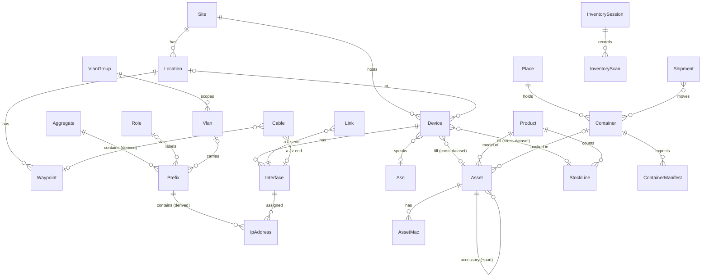

# Domain model (draft)

Status: draft, round 5. Ready to be turned into specs.

This app replaces the per-occurrence NOC spreadsheet ("<name> - Network Data", e.g. Kaigi on Rails 2026) and the standalone asset list ([rubykaigi-network-assets](https://docs.google.com/spreadsheets/d/1u27Eoip0GkvMGRFlqIeH5UZoMCDoXeYDKQ0GOxe7OJ0/edit)). Phase 1 covers IP addresses, subnets, assets, devices and inventory. Cables follow, after planning in the sheet (see [Cables](#cables)).

## Requirements

- An occurrence is an **Edition** (`rk25`, `rk25kor`, `rk26`, `rk26kor`), never a "conference". "Edition" is a working name; naming gets revisited later.
- Assets and inventory (the **Fleet**) have their own timeline, independent of Editions. Everything else, backbone and venue alike, belongs to an Edition's **Plan**, because the backbone changes during an Edition too.
- An Edition's Plan can fork from any earlier Edition, not only the latest: `rk26kor` forks from `rk26`, and `rk27` forks from `rk26`, not from `rk26kor`. Closed Editions stay readable for reference. The Fleet only needs snapshots.
- Each Edition records which Fleet version it was built with.
- Every write lands in a **streamlined changelog** for local-first clients. Conflicts resolve last-writer-wins in server commit order, and no submitted update is ever lost. Inventory tracking data in particular must never be lost.
- A client, mobile included, loads one Plan branch plus its linked Fleet branch in full. It never needs all branches at once.
- Generated files reach rubykaigi-net as one pull request per export, opened with a GitHub token from sts-cat. Agents may also read and write through the API.
- `hosts.txt` is replaced by a protojson export whose schema lives in `proto/`. `gen-hosts.rb` and the other automation in rubykaigi-net migrate onto it. The TSV format, which only suited copying from the sheet, is not kept.
- API callers authenticate with himari-issued tokens or with OIDC ID tokens from GitHub Actions and AWS IAM (`sts:GetWebIdentityToken`). Roles are assigned in himari.
- IPAM follows NetBox conventions, which the team already knows.
- `nwa.rubykaigi.org/<tag>` (the QR target on asset labels) opens the asset in this app.
- Cables stay planned in the spreadsheet, which remains their single source of truth. The app imports them repeatedly and handles ordering, receipt, preparing and sending. Cables are consumed per Edition.
- Out of scope: cost tracking (stays in a spreadsheet). Deferred: AP RF configuration, whose single source of truth is the WLC; mirroring it may come later.

## Sources surveyed

### Network Data sheet (kor26 = `rk26kor`)

| Tab | Columns | Maps to |
|---|---|---|
| `networks` | name, 使途, CIDR4, CIDR6, VLAN id, default gateway (v4, v6 suffix `::a`), dhcp pool | Role, Vlan, Prefix, IpRange |
| `addresses` | dc, network, CIDR, IP, name, iface, mac, update, configured?, remark | Device, Interface, IpAddress; `hosts.txt` is a TSV copy |
| `asns` | asn, name (`65010 er.venue`) | Asn |
| `locations` | `[tra] Hall C/メイン`, code, number (number retired) | Location |
| `devices` | ID, 種別 (retired), 場所, SKU, 備考, 調達先, asset tag, MAC | Device and its Fleet fill |
| `device-stock`, `device-sum` | 種別, SKU, 個数, 調達先; requested / stock / remain per category | Asset, StockLine, derived report |
| `ap-name-set command`, `ap-group-set` | true-name, mac-addr, asset-tag, WLC commands, 回収済 | Device + export |
| `ap-annotate`, `assets-ap-annotate` | BSSID (with `?` wildcard) → tag / location | AssetMac (`bssid`) + export |
| `device-tepra`, `ap-tepra` | ID, SKU, label parts | export |
| `入庫申請`, `cardboard-measurement` | box tag, note, W/D/H, count | Container, Shipment export |
| `inventory-check-*`, `kor26出庫` | box, asset URL, code (URL stripped to tag for XLOOKUP), ある? (cross-check) | InventorySession, InventoryScan |
| `cables`, `cables-sum`, `cables-order*`, `jj-order`, `cables-tepra*` | cable plan, measured length, medium, colour; order sums; JJ order; labels | Cable (imported), CableOrder + exports |
| `cost` | amount, desc | out of scope |

### Asset sheet (rubykaigi-network-assets)

- `master`: handle (tag), chassis, serial, mac, system, license, purchased_at, po, price, price-tax, location, comment.
- `README`: the tag grammar. Container prefixes: `rkc-` folding container, `rkb-` cardboard box (being phased out), `rks-` suitcase, `kor-` Kaigi on Rails cargo.
- `ap-annotate`: BSSID → AP tag. `tepra`: tag → `https://nwa.rubykaigi.org/<tag>`.
- `containers2022`, `containers2024`, `containers2024kor`, `containers2025tokyo12`: contents per box at each move. They mix asset tags, untagged devices (`IX2215 * 2 (tun-01,02.rk24)`) and consumables with rough counts (`はさみ 13本`, `2P電源タップ いっぱい`). `とりだす` marks what to ship from the warehouse; Kaigi on Rails is smaller and takes a subset.

### rubykaigi-net consumers

- `gen-hosts.rb` reads `hosts.txt` (`dc network cidr ip name iface mac`). It emits `<name>.<dc>.rubykaigi.net` A/PTR for the first row per `[dc, name, family]`, `<iface>.<fqdn>` for every row, and `<network>.<fqdn>` CNAMEs. It also writes `deadman.conf`.
- Kea reservations keyed by MAC, DUID or client-id `\0<asset tag>` (`reservations_asset_tag.libsonnet`). Pools and options stay in the repo.
- `route53/rubykaigi.net.route`: `es-<area>-NN.venue` → `<asset tag>.venue` CNAMEs. Other hand-kept records stay in the repo.
- glazed, SNMP and trapbridge host lists by platform; the per-Edition cloudprober exclusion list; itamae node attributes (addresses, DUIDs, ASNs).

## Datasets

| Dataset | Timeline | Entities |
|---|---|---|
| **Fleet** (one, global) | continuous on main; frozen snapshots | Product, Asset, AssetMac, PurchaseOrder, Place, Container, ContainerManifest, StockLine, StockAdjustment, Shipment, InventorySession, InventoryScan |
| **Plan** (one main branch per Edition) | forked from any earlier Plan branch; frozen when the Edition closes | Site, Location, Role, Rir, Aggregate, VlanGroup, Vlan, Prefix, IpRange, IpAddress, Device, Interface, Link, Asn, Waypoint, Cable, CableOrder |

- The only cross-dataset reference is Plan → Fleet: a Device's fill (an Asset or a StockLine) and a Cable's container once packed. Fleet never points at a Plan, apart from an optional Edition label on a Shipment or InventorySession.
- Each Plan branch belongs to one Edition, so per-Edition facts live directly on Plan rows. `es-tra-01`'s location, asset and deployed state are columns of its Device row in `rk26kor`. Forking `rk27` from `rk26` copies the Devices, and the fills are then edited.

## Branches and snapshots

### Concepts

- **Edition** (`edn`): `slug` (unique: `rk26`, `rk26kor`), `name`, `organizer` (rk/kor), `starts_on`, `ends_on`, `venue_name`, `status` (`planning` | `setup` | `live` | `teardown` | `closed`).
  - `plan_branch`: the Edition's main Plan branch.
  - `fleet_branch`: the Fleet branch that fills resolve against. This is Fleet main while the Edition is open, and the Fleet snapshot taken at close.
  - The slug doubles as the `#rk26` interface-description tag.
- **Branch** (`br`): one line of history of one dataset.
  - `dataset` (`fleet` | `plan`), `edition` (Plan branches only), `name` (`main`, or a snapshot label)
  - `parent`, `forked_at_seq` (null for a root)
  - `head_seq` (see [Changelog](#changelog)), `frozen`, `state` (`preparing` | `ready`)
- **Snapshot**: a frozen branch. It keeps its own rows, so reading it never replays history.

Operations:

- **Fork an Edition**: create a Plan branch from any Plan branch at its head, typically a closed Edition's frozen main. The fork graph is the `parent` chain: `rk26 → rk26kor`, `rk26 → rk27`.
- **Close an Edition**: freeze its Plan branch, snapshot Fleet main, and point `fleet_branch` at the snapshot.
- **Fleet snapshot** at any other moment, e.g. after an audit. Fleet main is the only writable Fleet branch.
- **Import a past Edition** (rk25, rk26 …) from its sheet into a frozen Plan branch. Pair it with a Fleet snapshot rebuilt from that year's `containers20xx` tab where one exists.
- **Merge** is not planned. Cherry-picking single entities across branches works through lineage.

### Eager copies

Forks and snapshots copy rows eagerly. The data is small (about 460 addresses, a few hundred devices, ~260 assets, ~1,300 cables), and every read stays a plain `where branch_id = ?`. DSQL allows 3,000 mutated rows and 10 MiB per transaction, so copying runs as a background job in chunks. The branch stays `preparing`, and rejects writes, until the job finishes.

### Row identity

- Every branched table has a UUID primary key `id` (a TypeID in the API), unique per row and per branch, plus `branch_id` and `lineage`.
- `lineage` stays the same when a row is copied into a fork, and is unique per branch.
- References inside a branch are ordinary foreign keys on `id`. A fork rewrites them through a lineage map while copying. Single-column keys keep Rails and `typeid_rails` simple.
- Cross-dataset references (Device → Asset) store the target's `lineage` and resolve within the Edition's `fleet_branch`.
- Branch diffs, "this device in rk25", and cherry-picks join on `lineage`. The API exposes it.
- `lineage` is the `id` of the row's first incarnation: a UUID, exposed as a TypeID with the entity's prefix. Clients generate it together with `id` when they create a row. That matters offline: a scanner at the venue can register a new asset and assign it to a Device before syncing, and the cross-dataset reference needs the asset's lineage at once. A server-assigned number would not exist yet.
- Neither `id` nor `lineage` is meant for people. People refer to natural keys:
  - asset and container tags
  - Edition slug + device FQDN (`rk26kor` / `es-tra-01.venue`)
  - cable IDs
  - prefixes and addresses
- UI URLs use natural keys where they are stable (`nwa.rubykaigi.org/<tag>`, `/<edition>/devices/<site>/<name>`). They fall back to TypeIDs for rows without one.

## Changelog

Every branch has an append-only changelog. It is the sync feed for clients and the audit history.

- **ChangeSet** (one per committed transaction): `branch_id`, `seq`, `actor`, `mutation_id`, `committed_at`.
- **Change** (one per touched row): `branch_id`, `seq`, `entity_type`, `entity_id`, `op` (`upsert` | `delete`), `data` (full after-image, jsonb; null on delete).
- **Mutation** (journal of client submissions): `id` (client-generated idempotency key), `branch_id`, `actor`, `entity_type`, `entity_id`, `payload` (fields the client set), `base_seq`, `client_time`, `received_at`, `outcome` (`applied` | `partially_superseded` | `rejected`), `applied_seq`, `overwritten` (the values it replaced that someone else had set after `base_seq`).
- `actor` identifies a human or machine caller: issuer plus subject (a himari user, a GitHub Actions workflow, an AWS IAM role), with a display name.

Rules:

- A write transaction increments `branches.head_seq` and uses the new value as its `seq`. Concurrent writers on one branch conflict on that row, so DSQL's OCC orders commits. Every `seq` then appears in commit order with no gaps, and a client that has applied up to N misses nothing by asking for `> N`. DSQL sequences cannot provide this, because they hand out cached blocks with gaps and out of commit order.
- Conflicts resolve per field, last writer wins, in server commit order. Overwritten values are recorded on the Mutation that overwrote them. The journal keeps every payload ever submitted, so an operator can restore any of them.
- Inventory data is insert-only. Scans, shipments and stock adjustments are new rows, never updates, so concurrent scanning cannot lose a record. Derived state (an asset's container, a stock count) is updated in the same transaction.
- Entity tables hold current state plus `updated_seq`. Reading current state never needs the changelog.
- Client bootstrap: fetch all rows of one Plan branch and its Fleet branch with their `head_seq`, then pull or stream Changes after it. Frozen branches never change, so their bootstrap payloads can be cached on S3/CloudFront. Mobile clients keep only the active pair.
- Deletes appear as `delete` Changes and remove the row from the entity table.
- A fork writes one ChangeSet per copied chunk, so a new branch's log starts with a full image.

## Validation warnings

Some rules warn instead of rejecting. Warnings are computed per branch and shown in the UI and API:

- duplicate IP address in a branch (`10.33.22.150–155` today)
- asset tag kind not matching its product (`srnp` on a non-PoE switch)
- device fill not matching the device's required category
- cable ends or waypoints not matching Interfaces, Links or Locations (topology check)
- address outside every Prefix; Prefix outside every Aggregate
- device without a primary IP
- shipment that misses something the Plan needs (see [Shipment](#fleet))

## Entities: Plan

Natural keys are unique per branch (a unique index on `(branch_id, <key>)`). Every Plan table also carries `branch_id`, `lineage`, `updated_seq`, `created_at` and `updated_at`.

### Organisation

**Site** (`site`): the `<dc>` in `<host>.<dc>.rubykaigi.net`. Fields: `slug` (`hnd`, `nrt`, `itm`, `venue`, `apne1`, `usw2`, `transit`, `hot`, `tkyk`), `kind` (`pop` | `venue` | `cloud` | `external` | `staging` | `lab`), `description`.

**Location** (`loc`): an area inside a Site, as in NetBox. Fields: `site`, `slug` (`tra`, `fo0`, `lb0`, `noc`), `name` (`Hall C/メイン`), `parent` (optional). A second building at the venue (venue2 at RK2026) is a top-level Location under `venue`.

### IPAM (NetBox style)

The sheet's `network` names mix three ideas: function (`mgmt`, `life`), site or building (`mgmt2` for venue2, `tkyk-mgmt` for tkyk), and blocks held at a site (`aws`, `onpremises`, `pa`). The model separates them:

- function → **Role**
- where → **Site / Location**, with **VlanGroup** for repeated VLAN ids
- block → **Aggregate**, or a `container` **Prefix**

The hosts export carries role, VLAN and scope as separate fields, so its consumers no longer need a combined network name.

| Sheet name | Role | Scope | Notes |
|---|---|---|---|
| `mgmt` | mgmt | VlanGroup `venue` (vid 1000) | |
| `mgmt2` | mgmt | VlanGroup `venue2` (vid 1000, Location venue2) | |
| `tkyk-mgmt` | mgmt | Site `tkyk` | |
| `lo` | loopback | none | `is_pool` |
| `link` | p2p | none | holds Link prefixes |
| `aws` | cloud | Site `apne1` | under Aggregate `10.33.128.0/18` |
| `onpremises`, `kaigi` | none | none | `container` prefixes |
| `pa` | public | none | under Aggregate `192.50.220.152/29` etc. |

**Rir** (`rir`) and **Aggregate** (`agg`): the top-level blocks we hold or use. Examples: `10.33.0.0/16` (RFC 1918), `2001:df0:8500::/48` (APNIC), `192.50.220.152/29` (PA from transit), `10.33.128.0/18` (AWS).

**Role** (`role`): a function vocabulary shared by prefixes and VLANs. Values: `loopback`, `p2p`, `mgmt`, `life`, `air`, `usr`, `cast`, `public`, `cloud`, `nat64-outer`, …

**VlanGroup** (`vgrp`): a scope where VLAN ids are unique. Fields: `name`, scope (`site` or `location`).

**Vlan** (`vlan`): `group`, `vid`, `name`, `role`.

**Prefix** (`pfx`):
- `prefix` (CIDR), `family`
- `status`: `container` | `active` | `reserved` | `deprecated`
- `role`, `vlan`, `site` / `location` (nullable)
- `is_pool`
- `gateway` (full address; `::a` accepted as input shorthand)
- `dhcp_subnet_id` (Kea id, reference only), `description`
- Parents and children come from containment, as in NetBox. Carrier NGN prefixes are `active` prefixes with a note.

**IpRange** (`rng`): `start`, `end`, `role` (`dhcp_pool`, …), `description`. Informational only, since Kea pools stay in the repo.

**IpAddress** (`ip`):
- `address` (with prefix length, as NetBox stores it), `family`
- `status`: `active` | `reserved` | `deprecated` | `dhcp`
- `role`: `loopback` | `anycast` | `vip` | … (nullable)
- `interface` (nullable)
- `dns_name` (override; normally derived), `dns` (`emit` | `skip`)
- `dhcp_identifier_type` (`hw_address` | `duid` | `client_id`) and `dhcp_identifier`, exported as Kea reservations
- `configured_at`, `verified_at`, `remark`; these replace the sheet's `update` and `configured?` columns (`updated_at` is automatic)
- The containing prefix is derived, replacing the free-text CIDR column.

**Link** (`lnk`): a first-class point-to-point link built on the address model.
- `a_interface`, `z_interface`, `prefix4` (a /31 with role `p2p`), `prefix6` (the matching `ca22:<N>::/124`), `description`
- Creating a Link allocates the next free /31 and /124 and creates the four IpAddresses: the even v4 address and `::a` go to the A end, the odd address and `::b` to the Z end.
- Addresses stay directly editable. The topology check warns when a Link and its addresses disagree.

**Asn** (`asn`): `number`, `name` (`er.venue`), `rir`. Devices link to their ASN.

### Devices

**Device** (`dev`): a logical node, the `name` in `addresses` and the `ID` in `devices`.
- `site` and `name` together are unique (`tun-01` exists at hnd, nrt, itm and venue)
- `location` (nullable)
- `role` (derived from the name prefix for now: `br`, `er`, `cs`, `as`, `es`, `ap`, `tun`, `nat`, `wire`, `wlc`, …)
- `platform` (`junos` | `nec_ix` | `ios` | `aireos` | `linux` | `aws` | `other`)
- `required_category` (e.g. `L2: 1G PoE+`, for stock planning)
- Fill, one of:
  - `asset_lineage` (a tagged Fleet asset, owned or borrowed)
  - `stock_line_lineage` (an untagged item)
- `status`: `planned` | `deployed` | `not_deployed` | `collected`. This replaces the cloudprober exclusion list, the "not deployed" notes and 回収済.
- `primary_ip4`, `primary_ip6` (encouraged, as in NetBox)
- `asn`, `description`
- FQDN is derived: `<name>.<site>.rubykaigi.net`.

**Interface** (`iface`): `device`, `name` (`lo`, `ge-0/0/5.10`, `irb.1000`, `me0`, `venue2-vlan1000`), `mac` (nullable), `description`.

### Cables

The spreadsheet is the single source of truth for cable planning and measuring. The app imports it repeatedly: sheet-owned fields are overwritten on every import, and app-owned fields (order, receipt, prepare, ship state) are kept, matched by cable ID. Cables are consumed per Edition, so all cable data lives in the Plan.

**Cable ID grammar**: `<kind>:<a>@<a-location>/<z>[~a|~b] [<WAYPOINT_A>-<WAYPOINT_Z>]`, e.g. `E:ngn1@noc/xs1`, `C:as@are/trbE~a TRBFO-TRBFI`.
- `kind`: `E` External, `B` Backbone, `C` Core, `A` Access.
- `@<a-location>`: where the A end sits (`wlc@noc` is the WLC at location `noc`).
- Each end is a short device reference:
  - `<role><n>` names a device, e.g. `tun1` is `tun-01` and `xs1` is `xs-01`.
  - A bare role names the only device of that role, e.g. `wlc` or `as`.
  - `<location><role letter>[<n>]` names a device by location and role, e.g. `trbE` is the Edge switch at `trb`. When a location has several, they are numbered: `traE1`, `traE2` are `es-tra-01` and `es-tra-02`.
- `~a` / `~b`: the two members of a redundant pair.
- The waypoint pair names a 重畳区間 (overlapping section). That row is shared by every cable spanning the same pair of waypoints. A waypoint is a venue location where a JJ (female-female coupler) is placed, so no single cable is too long to deploy or to replace after a fault. `A` is the A-side termination and `Z` the Z-side termination.
- The parser needs a spike against the full sheet. Ends that do not resolve to a Device stay as text and raise a topology warning.

**Waypoint** (`wpt`): a JJ point at the venue. Fields: `location`, `code` (`TRBFO`, `SPOFI`), `description`.

**Cable** (`cbl`): one row of the `cables` tab.
- Sheet-owned:
  - `cable_id` (unique per branch), parsed into `kind`, `a_end`, `location`, `z_end`, `pair_member`
  - `waypoint_a`, `waypoint_z`
  - `shared_section` (true for a 重畳区間 row)
  - `required_length_m` (適正), `length_m` (長さ), `medium` (より線 細径, より線 通常径, 単線, OM3, …), `colour`, `coupler` (JJ count), `comment`
- Resolved: `a_interface`, `z_interface` (from the parsed ends when possible), feeding the topology check.
- App-owned:
  - `status`: `planned` | `ordered` | `received` | `prepared` | `shipped` | `installed`
  - `order_line`, `unboxed`, `labelled`
  - `container_lineage` (Fleet container, once packed)

**CableOrder** (`cord`) and **CableOrderLine** (`cordl`): an order to a vendor, grouping cables by medium, colour and length. Fields: `vendor`, `ordered_at`, `status`; per line, `quantity` and `received_quantity` (納品チェック). Exports cover order forms (`cables-order`, rasterised), JJ orders (`jj-order`) and labels.

## Entities: Fleet

Fleet tables carry the same `branch_id`, `lineage`, `updated_seq` and timestamps.

**Product** (`prod`): a model, SKU or consumable type.
- `name` / `sku` (`AIR-AP2802I-Q-K9`, `SRX300`, `軍手`, `結束バンド`), `vendor`
- `category`: a fixed vocabulary shipped as static records (frozen_record style): `L3: 1G Router`, `L2: 1G`, `L2: 1G PoE+`, `L2: 100M PoE+`, `Wi-Fi AP`, `WLC`, `Transceiver`, `Power`, `Tool`, `Consumable`, …
- `tracking`: `tagged` | `counted`
- `tag_kinds` (expected kinds such as `aph`, for the tag/product warning)
- `platform` (default for devices)

**Asset** (`ast`): one tagged item. Its tag is its identity for life.
- `tag` (`rk-srnp19a1`), parsed into `owner`, `kind`, `year`, `batch`, `number`, `part`
- `parent` (accessories such as `+psu`)
- `product`, `serial`
- `ownership`: `owned` | `borrowed`; for borrowed items, `lender` (Cookpad, …) and `external_id` (the lender's asset ID)
- A borrowed item can carry our own tag, its `external_id`, or both. At least one is required, and lookups and labels prefer our tag when it exists.
- Our tags on borrowed items use the owner prefix `ext-` with the usual grammar (`ext-srnp26a1`), and the asset is marked `ownership = borrowed`. A tag never changes, so an item bought later from its lender keeps its `ext-` tag and switches to `owned`.
- `system`, `license`: free text, to be refreshed by automation through the API later
- `purchase_order`, `price`, `tax`
- `status`: `available` | `deployed` | `lost` | `broken` | `disposed`
- Where it is: `container`, or `place`, plus `location_note` (a person, an office desk)
- `comment`

**AssetMac** (`mac`): `asset`, `kind` (`ethernet` | `bssid` | `other`), `mac`, `prefix_length`. An AP's BSSID range is a masked base: `70:b3:17:c7:6a:4?` is a /44.

**PurchaseOrder** (`po`): `handle` (`rk-po19a`), `purchased_on`, `vendor`, `owner`, `note`.

**Place** (`plc`): somewhere things are kept or sent. Fields: `name`, `kind` (`warehouse` | `office` | `venue` | `home` | `other`), `address`, `note`. Initial places: Stockmamoru (warehouse), ivry office (prep), sorah's home.

**Container** (`box`): a container that travels. Containers do not nest.
- `tag` (`rkc-21b`, `rkb-25c`, `rks-…`, `kor-…`)
- `kind`: `folding_container` (rkc) | `cardboard` (rkb) | `suitcase` (rks) | `other`
- `width_cm`, `depth_cm`, `height_cm`, `description` (個品備考)
- `place` (current)

**ContainerManifest** (`man`): the paper in each box, giving the expected number of items per type. Fields: `container`, `product` or `category`, `expected_quantity`, `note`. Checks compare it with scanned contents.

**StockLine** (`stk`): a counted holding, for untagged items.
- `product` (or a free-text `item` until a Product exists)
- `holder`: a container or a place
- `quantity`, `quantity_note` (rough counts such as "いっぱい", "残り少し")
- `ownership`, `lender`, `edition` (for a loan to one Edition)
- **StockAdjustment** (insert-only) records every change: `stock_line`, `delta`, `reason`, `session` (nullable).

**Shipment** (`shp`): containers moving between Places. The usual route is warehouse → office (prep) → venue → warehouse.
- `from_place`, `to_place`, `edition` (label), `containers`
- `requested_at`, `shipped_at`, `received_at`, `status`
- An outbound shipment from the warehouse requests a subset of containers (`とりだす`). Kaigi on Rails takes fewer than RubyKaigi.
- Validation against the Edition's Plan uses Device fills only:
  - every asset filling a `planned` Device must be in a requested container, or already at the destination
  - per product and category, the number of devices in the requested containers must cover the Plan's untagged fills and `required_category` counts
- Anything missing is a warning. ContainerManifests are for box checks, not shipment validation.
- The warehouse request form (入庫申請 and its outbound counterpart) is an export.

**InventorySession** (`invs`): one counting run.
- `kind`: `pack` (prep at the office) | `check` (at the venue, before shipping back) | `receive` | `audit`
- `place`, `edition` (label), `started_at`, `closed_at`, `note`
- Several people scan into one session at once (the old thread-1 / thread-2 columns).

**InventoryScan** (`scan`): insert-only.
- `session`, `container` (nullable), `asset` or `stock_line` (with `quantity`)
- `scanned_by`, `scanned_at`
- `result`: `present` | `missing` | `unexpected`
- A scan updates `asset.container` / `asset.place` in the same transaction. The old ある? cross-check becomes a comparison of scans with the ContainerManifest and with the previous session.

## Exports

Each export reads one branch at one `seq`, so its output can be reproduced.

- Pull request to rubykaigi-net (one per export, token from sts-cat):
  - One protojson file per model, not per consumer, e.g. `sites.json`, `locations.json`, `vlans.json`, `prefixes.json`, `devices.json`, `interfaces.json`, `ip_addresses.json`, `links.json`, `asns.json`. Each holds a message with one repeated field of that model's proto message, the same messages the API serves.
  - Rows reference each other by natural key (device by site + name, prefix by CIDR), with the TypeID alongside. Consumers can join files without knowing internal ids, and diffs in a PR stay readable.
  - Consumers derive their own outputs from these files:
    - `gen-hosts.rb` derives Route53 records and `deadman.conf`.
    - Kea reservations come from addresses with DHCP identifiers.
    - `es-*` CNAMEs come from Devices and their Asset fill (a device file field carries the filled asset's tag).
    - glazed, SNMP and trapbridge lists come from Devices by platform.
    - cloudprober targets come from Devices by `status`.
  - The PR touches only the files whose content changed.
- Downloads:
  - WLC commands (`ap name <loc-name> <mac>`, `ap group-name <group> <name>`, reset `ap name <tag> <mac>`)
  - Tepra labels as CSV or XLSX (XLSX for fibre labels with `\n` in a cell)
  - asset QR labels
  - cable order forms and JJ orders
  - warehouse shipment requests (入庫申請)
  - `device-sum` style stock report (requested per category vs available, PoE switches in particular)

## Storage notes (DSQL)

- `inet` and arrays exist only at query runtime, and `jsonb` has no index support. Addresses and prefixes are stored as canonical text plus a sortable key: `family` (smallint), a fixed-width hex string (8 or 32 chars) and `prefix_length`. Containment is a range scan on the hex key, and `inet` casts still work inside queries. MACs use the same scheme (12 hex chars plus `prefix_length`).
- 3,000 mutated rows and 10 MiB per transaction, so forks, snapshots and imports copy in chunks.
- Up to 24 indexes per table and 8 columns per index: enough for `(branch_id, natural key)` and `(branch_id, lineage)`.
- No DSQL sequences: identifiers are UUIDs, and changelog order comes from `branches.head_seq`.

## Open questions

None outstanding from rounds 1–4. Left for later: naming of "Edition", and spikes on the lineage scheme in Rails, the cable ID parser, and the client sync protocol.
